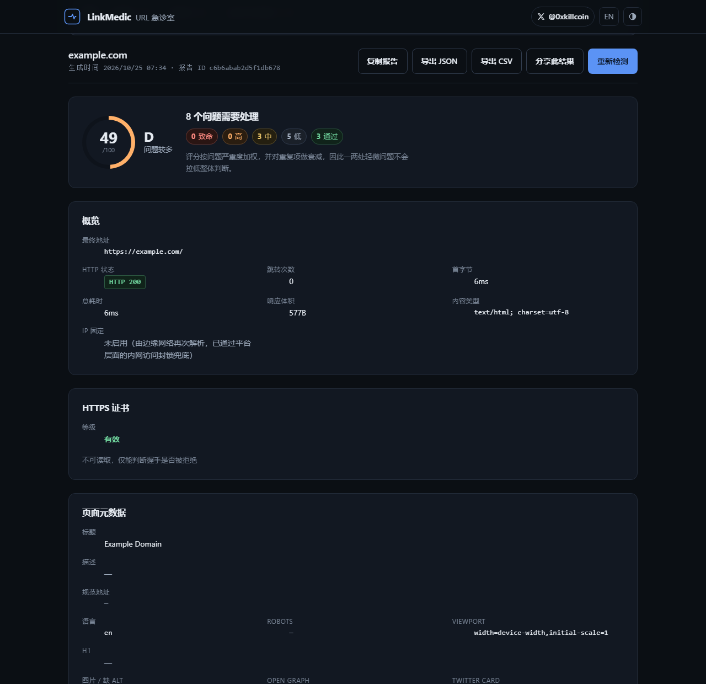
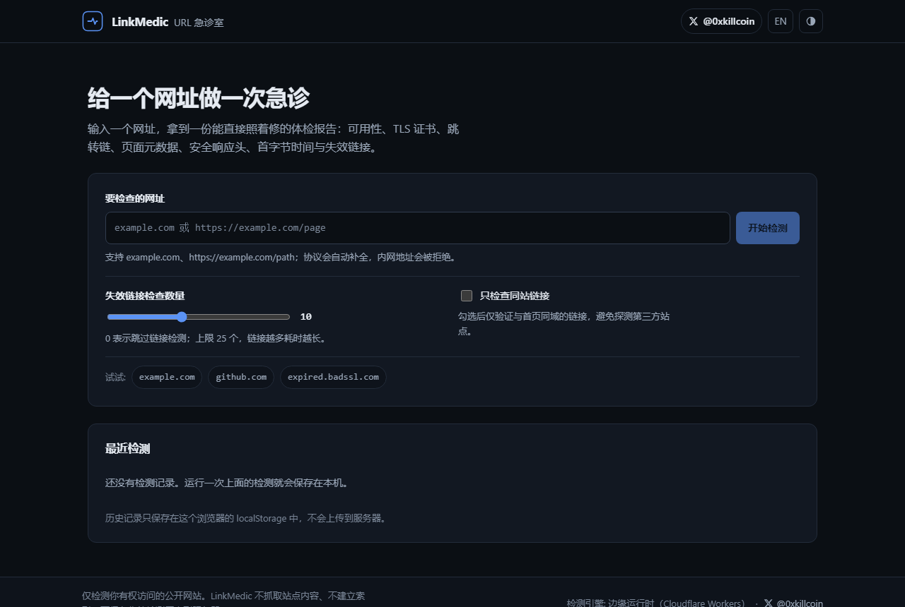
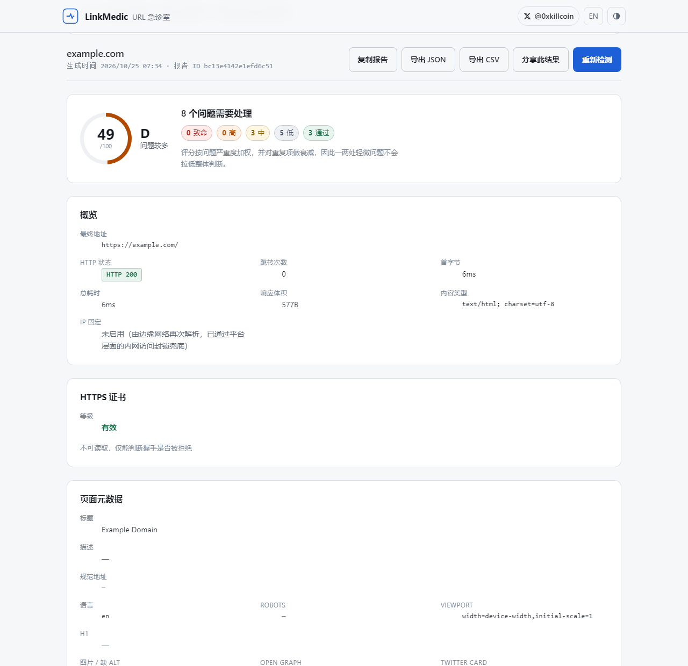
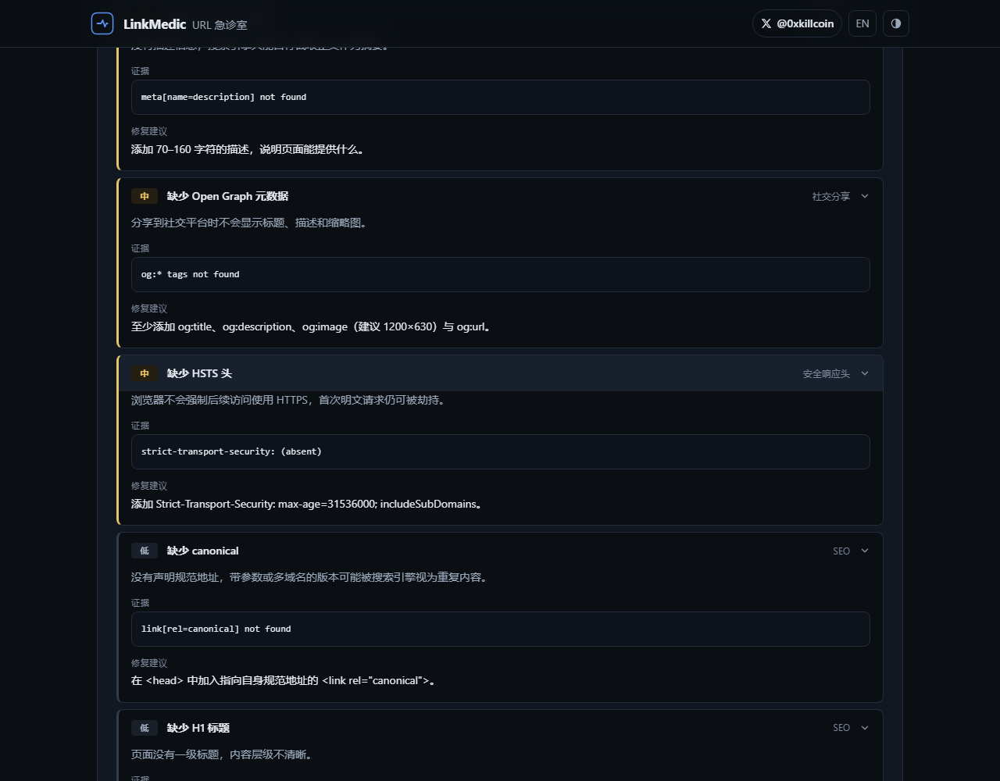
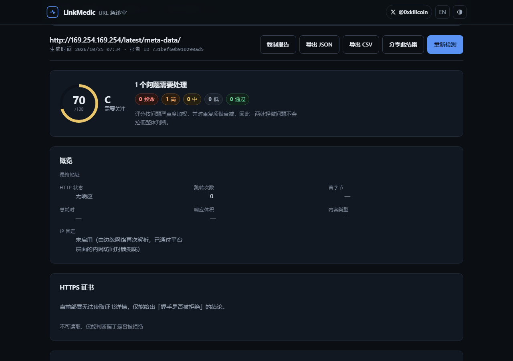
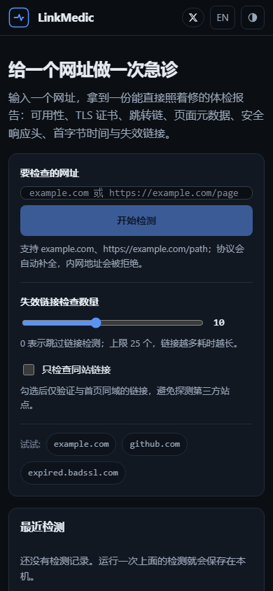
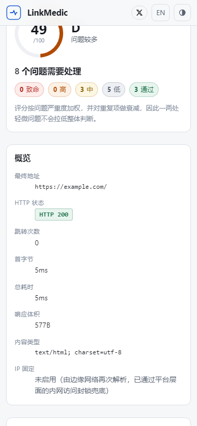

<div align="center">

# LinkMedic

### URL 急诊室 · The URL emergency room

**Paste a URL. Get a diagnosis you can act on — not a wall of green ticks.**

[](https://github.com/iiiiiiiiiiiiiKK/linkmedic/actions/workflows/ci.yml)
[](LICENSE)
[](https://www.typescriptlang.org/)
[](https://workers.cloudflare.com/)
[](#-testing)

[**Live demo**](https://linkmedic.pages.dev) · [Security policy](SECURITY.md) · [Report a bug](https://github.com/iiiiiiiiiiiiiKK/linkmedic/issues)

<a href="https://x.com/0xkillcoin">
  
</a>



</div>

---

## What problem does this solve?

A link is broken. A page is slow. A certificate expired three days ago. A site answers `526`, `403` or nothing at all — and the browser gives you one useless sentence. You then open devtools, `curl -I`, an SSL checker, a redirect tracer, a meta-tag inspector and a link checker, and stitch the answers together by hand.

**LinkMedic does that in one request.** It fetches the page the way a careful engineer would, records the _evidence_ for every conclusion, and tells you what to change. Every finding carries the observation that produced it, so you can disagree with the tool and still keep the data.

It is not a dashboard of decorative numbers. It is a triage report.

---

## Table of contents

- [Screenshots](#-screenshots)
- [What it checks](#-what-it-checks)
- [Quick start](#-quick-start)
- [Architecture](#-architecture)
- [The SSRF problem](#-the-ssrf-problem-and-how-linkmedic-handles-it)
- [API reference](#-api-reference)
- [Report format](#-report-format)
- [Testing](#-testing)
- [Deployment](#-deployment)
- [Self-hosting with full certificate inspection](#-self-hosting-with-full-certificate-inspection)
- [Environment variables](#-environment-variables)
- [Privacy](#-privacy)
- [Known limitations](#-known-limitations)
- [Roadmap](#-roadmap)
- [Contributing](#-contributing)
- [License](#-license)

---

## Screenshots

All images are captures of the **deployed application**, produced by `npm run screenshots` (Playwright + Chromium), not mockups.

| Desktop · dark                                             | Desktop · light                                                       |
| ---------------------------------------------------------- | --------------------------------------------------------------------- |
|  |  |

| Evidence drawer                                       | Blocked target                                      |
| ----------------------------------------------------- | --------------------------------------------------- |
|  |  |

| iPhone (390 × 844)                                  | iPhone · report                                         |
| --------------------------------------------------- | ------------------------------------------------------- |
|  |  |

---

## What it checks

Every row below is implemented in `shared/core/` and covered by tests. Nothing in this table is a placeholder.

### Availability & redirects

| Check                       | Detail                                                     | Severity when it fails     |
| --------------------------- | ---------------------------------------------------------- | -------------------------- |
| HTTP status                 | Final status of the redirect chain                         | 5xx → critical, 4xx → high |
| Redirect chain              | Every hop with status, `Location`, latency and resolved IP | > 2 hops → medium          |
| Redirect loops              | Detects a hop that repeats an earlier URL                  | critical                   |
| Redirect budget             | Hard stop at 5 hops                                        | critical                   |
| Redirect into private space | Each hop re-runs the full SSRF gate                        | blocked, reported as info  |
| Timeout                     | Per-request timeout + whole-run budget                     | critical                   |

### TLS / HTTPS

| Check                | Detail                                                                                                                                             | Severity               |
| -------------------- | -------------------------------------------------------------------------------------------------------------------------------------------------- | ---------------------- |
| HTTPS in use         | Final URL scheme                                                                                                                                   | critical if plain HTTP |
| Certificate validity | Node: full chain validation via `getPeerCertificate()`. Edge: the handshake verdict (HTTP 526 from Cloudflare means "origin certificate rejected") | critical               |
| Expiry window        | Warns at ≤ 14 days, escalates at ≤ 5 days                                                                                                          | medium / high          |
| Certificate details  | Subject, issuer, validity window, days remaining, TLS protocol, SHA-256 fingerprint — **Node transport only**                                      | info                   |

### Page metadata

`<title>` (presence + 30–60 char window) · meta description (presence + 70–160 chars) · `rel=canonical` (presence, cross-origin detection) · `robots` directives incl. `noindex` detection · `<html lang>` · `meta viewport` (the single most common cause of an unreadable mobile page) · H1 count · images missing `alt` · Open Graph (`og:title`, `og:description`, `og:image`) · Twitter card · `hreflang` alternates · favicon · charset declaration.

### Performance

Time to first byte (600 / 1000 / 2000 ms thresholds) · total response time · decoded body size · truncated-read detection · missing compression on large HTML · uncacheable HTML (`no-store` / `max-age=0`).

### Security headers

`Strict-Transport-Security` · `Content-Security-Policy` · `X-Content-Type-Options` · `Referrer-Policy`. Each finding names the exact header value to add.

### Broken links

Extracts every `<a href>` from the document, resolves relative URLs against `<base>` if present, de-duplicates, then probes up to **25** links (configurable, 0 disables) with `HEAD` and a `GET` fallback, 4–5 at a time, bounded by the run budget. Links pointing at private hosts, non-HTTP schemes or the time budget are **skipped and counted**, never silently dropped.

### Report & workflow

Overall 0–100 health score with an A–F grade · per-finding severity (`critical` / `high` / `medium` / `low` / `info` / `pass`) · evidence block per finding · bilingual (中文 / English) copy in the report itself, so exported JSON stays portable · **JSON export**, **CSV export** (RFC 4180 + formula-injection neutralisation), **copy as text**, **shareable result link** · local history (last 12 runs, `localStorage` only).

---

## Quick start

```bash
git clone https://github.com/iiiiiiiiiiiiiKK/linkmedic.git
cd linkmedic
npm install
```

**Run the full stack locally (Node server, full certificate inspection):**

```bash
npm run build:all     # builds the SPA into dist/ and the server bundle into build/
node server/index.mjs  # http://127.0.0.1:8787
```

**Run the Cloudflare-flavoured stack locally (same runtime as production):**

```bash
npm run build
npx wrangler pages dev dist --port 8788
```

**Frontend with hot reload:**

```bash
node server/index.mjs        # terminal 1 — API on :8787
LINKMEDIC_API=http://127.0.0.1:8787 npm run dev   # terminal 2 — Vite on :5173
```

No API keys, no database, no external account is required to run it.

---

## Architecture

```
                    ┌─────────────────────────────────────────┐
   browser ────────▶│  React 18 SPA (Vite, no UI framework)   │
                    │  src/                                   │
                    └───────────────┬─────────────────────────┘
                                    │ POST /api/analyze
                    ┌───────────────▼─────────────────────────┐
                    │  thin API layer                          │
                    │  functions/api/*.ts  (Cloudflare Pages)  │
                    │  server/index.mjs    (Node http)         │
                    │  rate limit · body caps · error shaping  │
                    └───────────────┬─────────────────────────┘
                                    │
                    ┌───────────────▼─────────────────────────┐
                    │  shared/core — the entire product logic  │
                    │  url · dns · ip · htmlparse · diagnostics│
                    │  scoring   (identical for both targets)  │
                    └───────────────┬─────────────────────────┘
                                    │ Transport interface
              ┌─────────────────────┴──────────────────────┐
              │                                            │
   ┌──────────▼───────────┐                   ┌────────────▼─────────────┐
   │ EdgeTransport        │                   │ NodeTransport            │
   │ fetch() + DoH        │                   │ pinned-IP sockets        │
   │ cert verdict only    │                   │ full certificate details │
   │ Cloudflare Workers   │                   │ any Node 20 host         │
   └──────────────────────┘                   └──────────────────────────┘
```

**Why the split?** The diagnostics engine never touches the network directly — it talks to a `Transport` interface. That keeps the security policy in one place, makes the engine 100 % unit-testable with a stub transport, and lets the same code run on an edge runtime that has no sockets _and_ on a Node host that does.

**Why no shared component library?** The UI is ~15 KB of hand-written CSS on design tokens. A component framework would have doubled the bundle to render one form and a table.

```
src/                 React app (components, hooks, export helpers, i18n)
shared/core/         transport-agnostic logic: url, dns, ip, htmlparse, diagnostics, scoring, types
shared/transport/    edge.ts (fetch) · nodetransport.ts (pinned sockets + TLS)
functions/           Cloudflare Pages Functions: /api/analyze, /api/health, shared http helpers
server/              self-host Node server (static + API)
tests/               Vitest: 157 unit + integration tests
e2e/                 Playwright-driven browser suite and live-target matrix
docs/screenshots/    real captures used by this README
```

**Stack:** TypeScript 5.7 · React 18 · Vite 6 · Vitest 2 · Playwright (via `playwright-core`) · Cloudflare Pages + Functions + KV · Node 20+.

---

## The SSRF problem and how LinkMedic handles it

> A tool that fetches arbitrary URLs is, by construction, a proxy into whatever network it runs on. Most "URL checker" projects get this wrong.

LinkMedic refuses at four independent layers:

**1. Input gate** (`shared/core/url.ts`) — only `http:`/`https:`; no embedded credentials; no `localhost`, `*.local`, `*.internal`; no single-label hosts; only ports 80 and 443 (port scanning is impossible); no control characters; ≤ 2048 chars.

**2. Address gate** (`shared/core/ip.ts`) — hand-written IPv4/IPv6 parsers, so encoded forms cannot slip past. Blocks loopback, RFC1918, CGNAT, link-local, cloud metadata, multicast, documentation, benchmark, reserved, and the IPv6 equivalents (`::1`, `fc00::/7`, `fe80::/10`, `2002::/16`, `64:ff9b::/96`, …). **IPv4-mapped IPv6 is unwrapped and judged by the IPv4 rules**, so `::ffff:169.254.169.254` is refused like the literal would be.

**3. DNS gate** (`shared/core/dns.ts`) — every answer for a hostname must be publicly routable. **One private answer rejects the whole host**, because a mixed answer set is exactly what a rebinding attempt looks like.

**4. Per-hop gate** — redirects are never auto-followed. Each `Location:` goes back through gates 1–3 before a request is issued.

Then the transport closes the time-of-check/time-of-use gap differently per runtime:

|                      | Node transport                                                                               | Edge transport                                                                                                         |
| -------------------- | -------------------------------------------------------------------------------------------- | ---------------------------------------------------------------------------------------------------------------------- |
| Connection target    | **Pinned** to the validated IP via a custom `lookup` — the resolver is never consulted again | The edge re-resolves DNS itself                                                                                        |
| Rebinding protection | Structural (no second lookup exists)                                                         | Platform: Workers refuse private/loopback/link-local connections (verified: `fetch('http://127.0.0.1/')` → error 1003) |
| Reported as          | `ipPinning: true`                                                                            | `ipPinning: false` — stated in the UI and in every report                                                              |

Resource limits: 512 KB page body, 16 KB per link probe, 12 s page / 6 s link timeouts, 5 redirects, 25 link probes at 4–5 concurrency, 24 s total budget, 8 KB request bodies, 20 diagnoses per IP per minute (KV-backed, fails open **and says so** if KV is unavailable).

Errors are sanitised before they reach a user: IPv4 addresses are redacted, stack traces are dropped, and the server logs an error _name_ — never a URL, a body or a header.

Full detail, including the exact blocked ranges: [SECURITY.md](SECURITY.md).

---

## API reference

### `POST /api/analyze`

```bash
curl -s https://linkmedic.pages.dev/api/analyze \
  -H 'content-type: application/json' \
  -d '{"url":"example.com","linkCheckLimit":10,"sameOriginLinksOnly":false}' | jq '.report.score'
```

| Field                 | Type    | Default | Notes                                                               |
| --------------------- | ------- | ------- | ------------------------------------------------------------------- |
| `url`                 | string  | —       | Required. Scheme optional (`example.com` → `https://example.com/`). |
| `linkCheckLimit`      | number  | `10`    | 0 disables link checking. Clamped to 25.                            |
| `sameOriginLinksOnly` | boolean | `false` | Only probe links sharing the page's origin.                         |

**Responses**

| Status | Meaning                                                                        | Body                                                       |
| ------ | ------------------------------------------------------------------------------ | ---------------------------------------------------------- |
| `200`  | Diagnosis completed (even if the site is down — look at `page` and `findings`) | `{ "report": { … } }`                                      |
| `422`  | The _URL_ was rejected by the safety policy                                    | `{ "report": { … }, "error": { "code", "message" } }`      |
| `429`  | Rate limited                                                                   | `{ "error": { "code": "rate_limited", "retryAfter" } }`    |
| `413`  | Body too large                                                                 | `{ "error": { "code": "payload_too_large" } }`             |
| `400`  | Missing/invalid JSON                                                           | `{ "error": { "code": "missing_url" \| "invalid_json" } }` |
| `500`  | Unexpected failure (no internals leaked)                                       | `{ "error": { "code": "internal_error" } }`                |

Input-rejection codes: `empty`, `too_long`, `invalid_characters`, `unsupported_scheme`, `invalid_url`, `missing_host`, `invalid_host`, `credentials_not_allowed`, `blocked_target`, `blocked_port`.

A `422` deliberately carries a full report so the UI can render it with the same components — the client never has to invent an error screen.

### `GET /api/health`

```json
{
  "status": "ok",
  "runtime": "cloudflare-workers",
  "capabilities": {
    "ipPinning": false,
    "certificateDetails": false,
    "certificateVerdict": true,
    "linkChecking": true,
    "sameOriginFilter": true
  },
  "limits": { "rateLimitPerMinute": 20, "maxLinks": 25, "rateLimitEnforced": true }
}
```

The UI reads this at boot and **tells the user which engine they are on** instead of pretending both runtimes behave identically.

---

## Report format

```jsonc
{
  "schemaVersion": 1,
  "id": "6f1c…",
  "createdAt": "2026-10-25T03:14:07.000Z",
  "engine": { "runtime": "node", "transport": "node-socket",
              "ipPinning": true, "certificateDetails": true },
  "target": { "requestedUrl": "https://example.com/", "host": "example.com", … },
  "page": {
    "finalUrl": "https://example.com/",
    "status": 200,
    "redirects": [ { "url": "…", "status": 301, "location": "…", "durationMs": 84, "ip": "…" } ],
    "timing": { "ttfbMs": 138, "totalMs": 214 },
    "certificate": { "valid": true, "source": "tls-inspection",
                     "issuer": "…", "validTo": "…", "daysRemaining": 61, "protocol": "TLSv1.3" }
  },
  "metadata": { "title": "…", "canonical": "…", "openGraph": { … }, "h1": [ … ] },
  "links": { "checked": [ … ], "totalFound": 42, "broken": 1, "skipped": 0, "truncated": true },
  "findings": [
    {
      "id": "description-missing",
      "check": "metadata",
      "severity": "medium",
      "status": "warn",
      "title": { "zh": "缺少 meta description", "en": "Missing meta description" },
      "detail": { "zh": "…", "en": "…" },
      "recommendation": { "zh": "…", "en": "…" },
      "evidence": "meta[name=description] not found",
      "weight": 8
    }
  ],
  "score": { "value": 72, "grade": "C", "counts": { "critical": 0, "high": 1, … } },
  "timings": { "totalMs": 1840, "fetchMs": 214, "linkCheckMs": 1200 },
  "warnings": []
}
```

**How the score works.** Each finding carries a severity weight (40 / 20 / 8 / 3 / 0). Deductions are summed and passed through `100 × (1 − e^(−d/55))`, so a long tail of cosmetic issues can never drown out a real failure. Any `critical` finding caps the score at 40 (grade F). `info` findings never deduct.

**Bilingual by construction.** Every finding stores both languages, so a report exported in Chinese is still readable by an English-speaking colleague a year later.

---

## Testing

```bash
npm test            # 157 unit + integration tests (Vitest, ~2 s)
npm run test:e2e    # 28 browser checks (Chromium, needs a running instance)
npm run test:live   # 16 real-world target cases (needs network)
npm run typecheck   # frontend + functions, strict, noUnusedLocals
npm run lint        # ESLint 9 flat config, 0 problems
npm run verify      # typecheck + lint + test + build
```

### Unit & integration — `157 passed` across 8 files

| File                  | Covers                                                                                                                                                                                                                                          |
| --------------------- | ----------------------------------------------------------------------------------------------------------------------------------------------------------------------------------------------------------------------------------------------- |
| `ip.test.ts`          | 44 assertions: every blocked range, IPv4-mapped IPv6, NAT64, 6to4, octal-looking octets, public ranges that must stay allowed                                                                                                                   |
| `url.test.ts`         | Scheme/credential/port/host rejection, normalisation, redirect resolution, charset parsing                                                                                                                                                      |
| `htmlparse.test.ts`   | Metadata extraction, `<base>` handling, entity decoding, script-content exclusion, unbalanced markup                                                                                                                                            |
| `dns.test.ts`         | Rebinding (single private answer, mixed answers), DNS failure, literal-IP short circuit                                                                                                                                                         |
| `diagnostics.test.ts` | **Stub transport** — happy path, 5xx/404, invalid certs, expiry window, plain HTTP, redirect loop, hop budget, redirect into private space, link failures, same-origin filter, skipped links, non-HTML responses, missing headers, report shape |
| `scoring.test.ts`     | Monotonicity, critical cap, damping of the long tail, grade boundaries                                                                                                                                                                          |
| `export.test.ts`      | CSV quoting/injection neutralisation, JSON round-trip, plain-text report, history de-duplication and cap                                                                                                                                        |
| `security.test.ts`    | Error redaction, CSP/HSTS headers, body caps, client key extraction, rate limiter (incl. fail-open paths)                                                                                                                                       |

### Browser E2E — `28/28 passed`

Run against the live deployment with a real Chromium:

```
PASS  author 𝕏 link points at x.com/0xkillcoin
PASS  browser can reach /api/health — cloudflare-workers
PASS  diagnosis produced a numeric score — 49
PASS  findings are rendered — 11 findings
PASS  finding expands to show the body
PASS  JSON export triggers a download
PASS  CSV has the findings header row
PASS  history recorded the run
PASS  private metadata address is refused
PASS  theme toggle changes data-theme — dark
PASS  language toggle switches to English
PASS  Enter key submits the form
PASS  no console errors during the desktop run
PASS  iPhone viewport has no horizontal overflow — overflow=0px
PASS  primary button is tap-sized (>=44px) — 44px
PASS  iPhone report view has no horizontal overflow
PASS  iPad viewport has no horizontal overflow
```

The mobile checks assert **zero horizontal overflow** at 390 × 844 and 834 × 1112 — the failure mode that "responsive" designs usually ship with.

### Live targets — `16/16 as expected`

```
PASS normal page               http=200  score=49   | pass     HTTPS certificate is valid
PASS redirect chain            http=200  score=85   | pass
PASS 404 page                  http=404  score=48   | high     Homepage returned 404
PASS expired certificate       http=526  score=11   | critical Invalid HTTPS certificate (edge reported 526)
PASS self-signed certificate   http=526  score=11   | critical Invalid HTTPS certificate
PASS wrong-host certificate    http=526  score=10   | critical Invalid HTTPS certificate
PASS oversized response        http=200  score=63   | pass
PASS slow / timing host        http=200  score=51   | pass
PASS invalid url                         score=70   | high     The URL is not valid
PASS loopback                            score=70   | high     The URL is not valid
PASS private range                        score=70  | high     The URL is not valid
PASS cloud metadata                        score=70  | high     The URL is not valid
PASS malformed port scan                   score=70  | high     The URL is not valid
PASS non-http scheme                       score=70  | high     The URL is not valid
PASS redirect into private space           score=40  | info     Target blocked by the safety policy
PASS link checking enabled     http=200  score=49   | pass
```

### Accessibility & resilience

Keyboard-only submission verified in E2E; visible focus rings on every control; `aria-expanded` / `aria-controls` on every disclosure; `aria-live` regions for progress, errors and toasts; skip link; `prefers-reduced-motion` honoured; colour is never the only signal (every severity also carries a text badge). Loading, empty, error, timeout, rate-limited and partial-failure states all have dedicated UI.

---

## Deployment

### Cloudflare Pages (production — this is where the live demo runs)

```bash
npm run build
npx wrangler pages project create linkmedic --production-branch=main
npx wrangler pages deploy dist --project-name linkmedic --branch=main
```

`wrangler.toml` already declares the KV namespace used for rate limiting and the `LINKMEDIC_*` variables:

```toml
compatibility_flags = ["nodejs_compat"]
pages_build_output_dir = "./dist"

[[kv_namespaces]]
binding = "LINKMEDIC_KV"
id = "<your-kv-namespace-id>"

[vars]
LINKMEDIC_RATE_LIMIT = "20"
LINKMEDIC_MAX_LINKS = "25"
```

Functions are picked up automatically from `functions/`. Build command: `npm run build`. Output directory: `dist`. Node version: 20 or 22.

> **Why not GitHub Pages?** GitHub Pages serves static files only. LinkMedic's core value is server-side fetching — the browser cannot bypass CORS to measure a third-party site's status code, headers or redirect chain, and a purely client-side build would have to pretend those checks happened. The SPA is deployable anywhere; the API needs a function runtime.

### Vercel (alternative)

The Node API is a plain `node:http` handler, so Vercel works via a thin adapter. The bundling step already produces `build/core.js` and `build/server.js`; point an `api/analyze.ts` serverless function at `runDiagnostics(new NodeTransport(), …)`. Not shipped as a first-class target because Cloudflare Pages needs no adapter and gives the same runtime locally and in production.

### Self-hosting with full certificate inspection

```bash
npm run build:all
PORT=8080 HOST=0.0.0.0 node server/index.mjs
```

This gives you `ipPinning: true` and real certificate subjects, issuers, expiry dates and TLS protocol versions — none of which the edge runtime can read. Any Node 20 host works (VPS, Fly, Railway, Docker, a Raspberry Pi).

---

## Environment variables

| Variable               | Default                 | Applies to | Purpose                                                                                                      |
| ---------------------- | ----------------------- | ---------- | ------------------------------------------------------------------------------------------------------------ |
| `LINKMEDIC_RATE_LIMIT` | `20`                    | both       | Diagnoses per IP per minute                                                                                  |
| `LINKMEDIC_MAX_LINKS`  | `25`                    | both       | Hard ceiling for link probes                                                                                 |
| `LINKMEDIC_KV`         | —                       | edge       | KV binding for rate-limit counters; without it the limiter fails open and reports `rateLimitEnforced: false` |
| `PORT` / `HOST`        | `8787` / `127.0.0.1`    | node       | Listen address                                                                                               |
| `LINKMEDIC_BUDGET_MS`  | `30000`                 | node       | Whole-run wall-clock budget                                                                                  |
| `LINKMEDIC_API`        | `http://127.0.0.1:8788` | dev        | Where Vite proxies `/api/*`                                                                                  |
| `CHROME_PATH`          | auto                    | dev        | Chromium binary for the Playwright suites                                                                    |

**There are no secrets in this project.** No API keys, no database credentials, no third-party tokens. See [`.env.example`](.env.example).

---

## Privacy

- **Nothing is stored server-side.** The API builds a report in memory and returns it. No URL, header or body is persisted, queued or logged.
- **History is local.** The last 12 runs live in your browser's `localStorage` and never leave it. "Clear history" deletes them immediately.
- **No analytics, no cookies, no third-party scripts, no fonts from a CDN.**
- **Logs contain error names only** — never a URL, a header or a response body.
- **Errors are redacted** before display: IPv4 addresses are stripped, stacks are dropped, length is capped.

---

## Known limitations

Honest list — these are real, and the UI states them where relevant.

1. **The edge build cannot read certificate details.** Cloudflare Workers expose no API for the leaf certificate, so on `linkmedic.pages.dev` the certificate card shows a _verdict_ (valid / rejected) and says so. Deploy the Node server for subject, issuer, expiry and TLS version. The code returns `null` plus an explanation rather than fabricating values.
2. **No JavaScript execution.** LinkMedic fetches HTML; it is not a headless browser. Client-rendered SPAs may look thinner than they are — a missing `<title>` in the raw HTML is still a real SEO finding, but the page can look emptier than a visitor's experience.
3. **Rate limiting is fixed-window over KV.** KV is eventually consistent; treat it as an abuse brake, not a hard quota. Without a KV binding it fails open and reports that.
4. **Link probes send `HEAD` then `GET`** when a server rejects `HEAD` (405/403/501). Some WAFs count that as two requests.
5. **`ipPinning` is true only on the Node transport.** On the edge the DNS-rebinding guarantee comes from the platform, not from this code — and every report says so instead of implying otherwise.
6. **Only ports 80 and 443.** A site on `:8080` cannot be checked. That is deliberate: allowing arbitrary ports turns the tool into a port scanner.
7. **Single-page analysis.** There is no crawler; link checking samples one page's links.
8. **No persistence or accounts.** History is per-browser. There is no cross-device sync, no team workspace, no scheduled monitoring — those need a database and were out of scope for a tool that must stay free to run.

---

## Roadmap

- [ ] Optional scheduled re-checks with diffing (needs D1 or KV + a cron trigger)
- [ ] Lighthouse-style asset weight estimation (requires fetching subresources)
- [ ] Compare two URLs side by side
- [ ] Markdown export for pasting into an issue
- [ ] OpenAPI schema generated from the `DiagnosticReport` types
- [ ] Docker image for the Node server

---

## Contributing

Issues and pull requests are welcome.

```bash
git clone https://github.com/iiiiiiiiiiiiiKK/linkmedic.git
cd linkmedic && npm install
npm run verify        # typecheck + lint + tests + build — must be green
```

Guidelines:

- **New checks go in `shared/core/diagnostics.ts` with a bilingual `Finding`** (zh + en) and at least one unit test using the stub transport in `tests/diagnostics.test.ts`.
- **Never** weaken the SSRF guards to make a test pass. If a target is unreachable because of the policy, that is the correct behaviour — assert it.
- **Report only what was observed.** A check that cannot run reports `null` / `info` with an explanation; it never guesses.
- Run `npm run lint` and `npm test` before opening a PR. CI runs both on Ubuntu with Node 22, plus a live browser E2E job.

---

## License

[MIT](LICENSE) © 2026 LinkMedic contributors

<div align="center">

Built by [@0xkillcoin](https://x.com/0xkillcoin) · [Live demo](https://linkmedic.pages.dev) · [Security policy](SECURITY.md)

</div>
